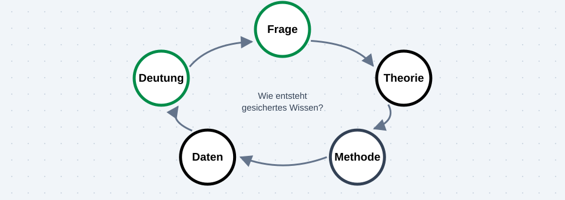

# Willkommen {.unnumbered}

::: {.oth-frame}
{.welcome-banner fig-alt="Kreislauf des Forschungsprozesses mit fünf Stationen: Frage, Theorie, Methode, Daten und Deutung. Pfeile verbinden die Stationen, von der Deutung führt ein Pfeil zurück zur Frage."}
:::

Woher wissen wir, was wir zu wissen glauben? Fachkräfte der Sozialen Arbeit treffen täglich Annahmen über ihre Adressat:innen, über Problemlagen und über die Wirkung von Angeboten. Viele dieser Annahmen stützen sich auf Erfahrung. Das ist wertvoll, reicht aber nicht immer aus. Die Lehrveranstaltung *Forschungstheorie* fragt deshalb, wie wissenschaftliches Wissen entsteht, wodurch es sich von Alltagswissen unterscheidet und wie wir es prüfen können.

Das Skript begleitet die Sitzungen. Es bündelt die zentralen Inhalte, erläutert die wichtigsten Positionen und Begriffe und bietet Lernspiele, mit denen Sie Ihr Wissen anwenden können. Es ersetzt nicht die Lektüre, erleichtert aber den Einstieg.

## Ziele der Lehrveranstaltung

Nach der Lehrveranstaltung können Sie

1. **unterscheiden**, wodurch sich wissenschaftliches Wissen von Alltagswissen abgrenzt und welche erkenntnistheoretischen Positionen die Sozialforschung prägen,
2. **entwickeln**, wie aus einer praxisrelevanten Frage ein Forschungsdesign mit Hypothesen und Operationalisierung entsteht,
3. **planen**, wie eine Stichprobe gezogen und Daten qualitativ oder mit einem Fragebogen erhoben werden,
4. **auswerten**, indem Sie qualitative Daten kodieren und einfache Kennwerte der deskriptiven Statistik berechnen,
5. **beurteilen**, ob eine Studie Gütekriterien und forschungsethische Standards erfüllt,
6. **übertragen**, welchen Beitrag Forschungsergebnisse für eine evidenzbasierte Praxis der Sozialen Arbeit leisten.

## Wo Sie anfangen können

::: {.grid .welcome-cards}

::: {.g-col-12 .g-col-md-6 .welcome-card}
[]{.bi .bi-journal-text .welcome-icon}

**Grundlagen · [Grundbegriffe](grundlagen/01-grundbegriffe.qmd)**

Die wichtigsten Begriffe zum Aufklappen, mit typischen Verwechslungen.
:::

::: {.g-col-12 .g-col-md-6 .welcome-card}
[]{.bi .bi-diagram-3 .welcome-icon}

**Sitzungen · [13 Sitzungen](index.qmd)**

Drei Blöcke: Wissenschaftstheorie und Design, Stichprobe und Erhebung, Auswertung und Transfer.
:::

::: {.g-col-12 .g-col-md-6 .welcome-card}
[]{.bi .bi-controller .welcome-icon}

**Üben · [Lernspiele](03-lernspiele.qmd)**

Memory zu den Grundbegriffen und Aussagen den Positionen zuordnen.
:::

::: {.g-col-12 .g-col-md-6 .welcome-card}
[]{.bi .bi-check2-circle .welcome-icon}

**Üben · [Lernkontrolle](04-lernkontrolle.qmd)**

Prüfen Sie, was Sie sicher anwenden können.
:::

:::

## Hinweis zur Transparenz

Künstliche Intelligenz wurde eingesetzt, um die Lernspiele zu programmieren, Texte und Erläuterungen zu entwerfen und die Abbildung auf dieser Seite zu erstellen. Alle Inhalte wurden vom Autor geprüft, der für sie verantwortlich ist.
